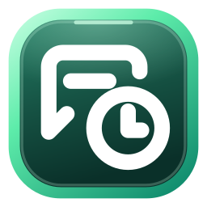

<p align="center">
  
</p>

<h1 align="center">ABINADWAN Plugins Suite</h1>

<p align="center">
  A modular, open-source plugin bundle for
  <a href="https://github.com/deepseek-ai/deepseek-harness">DeepSeek Harness (DSH)</a>.
</p>

<p align="center">
  <a href="https://github.com/abinadwan/DSH-ABINADWAN-Plugins-Suite/actions/workflows/test.yml"></a>
  <a href="https://github.com/abinadwan/DSH-ABINADWAN-Plugins-Suite/releases/tag/v1.0.0"></a>
  <a href="LICENSE"></a>
</p>

> **Latest release: [v1.0.0](https://github.com/abinadwan/DSH-ABINADWAN-Plugins-Suite/releases/tag/v1.0.0).** The tagged source is published from `main` with the owner’s approval. Consult the release notes for the remaining Windows Desktop and Host-level security verification limits. For installation, use the full commit SHA shown by the published release rather than tracking `develop`.

## Overview

The suite installs as **one DSH bundle** containing **six independently toggleable components**. Each component has its own icon, metadata and activation state. For consistency, this README links to the full feature reference instead of repeating partial feature descriptions.

| Component | Default | Full description |
| --- | --- | --- |
|  **Environment & Context** | On | [Details](docs/DETAIL.md#environment--context) |
|  **Humanizer** | On | [Details](docs/DETAIL.md#humanizer) |
|  **My Profile** | Off | [Details](docs/DETAIL.md#my-profile) |
|  **Direct Chat** | Off | [Details](docs/DETAIL.md#direct-chat) |
|  **Chat Control** | Off | [Details](docs/DETAIL.md#chat-control) |
|  **Adaptive Reasoning** | Off | [Details](docs/DETAIL.md#adaptive-reasoning) |

[Complete component capabilities and limitations](docs/DETAIL.md) · [Documentation index](docs/README.md)

## Technologies and architecture

| Layer | Technology / integration |
| --- | --- |
| Plugin runtime | **JavaScript ES modules (ESM)**, **Cordis** plugin loading, DSH's native package bundle and `cordis.patch.yml` |
| Host integration | DSH **Plugin Manager**, Skills, native Session/Workspace APIs, Settings/Remote services and access controls |
| Interface | DSH native UI slots and **React** components; component-specific locale and icon exports |
| Localization | Locale dictionaries, including bundled Arabic translations for the DSH interface; component language choices remain governed by their own settings |
| Configuration | One package with separate component identities and Host-managed settings; no independent application server required |
| Testing | **Node.js `node:test`**, React/DOM fixtures, **jsdom**, **axe-core**, native contract checks and packaged-artifact validation |
| CI | **GitHub Actions** on Windows and Linux with Node.js **22 and 24** |

The package is distributed as ready-to-run JavaScript. Installing it into DSH **does not require a local build step**. Node.js and npm are needed for contributor development and testing, not for ordinary installation through Harness Desktop.

The `package.json` exports and `cordis.patch.yml` define the bundle, while the package-root client registers UI integrations against services provided by DSH. The build is tested against pinned DSH development dependencies; real Desktop behavior is a separate acceptance boundary.

## Installation (Harness Desktop)

1. Open **DeepSeek Harness Desktop** and select the **Profile** in which the plugin should run.
2. Visit [GitHub Releases](https://github.com/abinadwan/DSH-ABINADWAN-Plugins-Suite/releases) and choose an approved, **published stable release**. Obtain the complete **40-character commit SHA** of its verified source revision.
3. In Harness, open **Plugins → Add plugin**, select its supported Git/GitHub installation method and supply this reference with the actual SHA:

```text
github:abinadwan/DSH-ABINADWAN-Plugins-Suite#RELEASE_COMMIT_SHA
```

4. Complete the installation through the native Plugins UI, then **restart Harness** if requested.
5. Open **Plugins → ABINADWAN Plugins Suite**, enable the bundle and select the components you want to activate.

**Do not paste `RELEASE_COMMIT_SHA` literally.** Replace it with the exact full commit SHA of the published [v1.0.0 Release](https://github.com/abinadwan/DSH-ABINADWAN-Plugins-Suite/releases/tag/v1.0.0). For later development commits, use a reviewed full SHA in a disposable DSH Profile rather than upgrading your normal installation.

**Profile separation matters:** Desktop and CLI can use different DSH Profiles. Installing into a CLI Profile does not necessarily install into the Desktop Profile. Before replacing an existing installation, preserve its known-good revision, configuration and any relevant user backup.

### Manual updates

The suite detail view includes **Suite updates (GitHub Releases)**, with a read-only release check and user-confirmed update action for eligible full-SHA-pinned Git installations. Actual installation is delegated to the native DSH Plugin Manager. **There is no unattended update**, and failure recovery/restart behavior depends on the Host. For version eligibility, manual migration from unpinned Git installs, security limitations and recovery guidance, see [Installation and updates](docs/DETAIL.md#installation-and-updates).

## Development

A local development environment requires **Node.js 22 or 24** and npm:

```sh
git clone https://github.com/abinadwan/DSH-ABINADWAN-Plugins-Suite.git
cd DSH-ABINADWAN-Plugins-Suite
git checkout develop
npm ci --ignore-scripts
npm test
npm run check:package
```

`npm test` covers component/runtime contracts, UI fixtures, documentation references and the configured safety cases. `npm run check:package` creates and checks the packaged plugin against its source expectations. CI exercises these checks on both Windows and Linux.

Development on `develop` does not publish a GitHub Release or change an existing Desktop installation. Read [CHANGELOG.md](CHANGELOG.md) for changes and [docs/README.md](docs/README.md) to distinguish active documentation from historical research and plans.

## Documentation and project policy

- [Component functionality, constraints and troubleshooting](docs/DETAIL.md)
- [Documentation index and historical archive](docs/README.md)
- [Release history](CHANGELOG.md) · [Security policy](SECURITY.md) · [Third-party notices](THIRD_PARTY_NOTICES.md)
- [Artwork provenance](docs/BRANDING.md) · [License](LICENSE)

The suite is an independent community project distributed under the **MIT License**; it is not an official DeepSeek product. DSH and third-party names belong to their respective owners.
