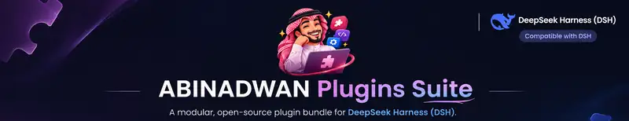

<p align="center">
  
</p>

<table align="center">
  <tr>
    <td align="center" width="130"><a href="docs/DETAIL.md#environment--context"></a><br/><sub><b>Environment &amp;<br/>Context</b></sub></td>
    <td align="center" width="130"><a href="docs/DETAIL.md#humanizer"></a><br/><sub><b>Humanizer</b></sub></td>
    <td align="center" width="130"><a href="docs/DETAIL.md#my-profile"></a><br/><sub><b>My Profile</b></sub></td>
    <td align="center" width="130"><a href="docs/DETAIL.md#direct-chat"></a><br/><sub><b>Direct Chat</b></sub></td>
    <td align="center" width="130"><a href="docs/DETAIL.md#chat-control"></a><br/><sub><b>Archive Manager</b></sub></td>
    <td align="center" width="130"><a href="docs/DETAIL.md#adaptive-reasoning"></a><br/><sub><b>Adaptive<br/>Reasoning</b></sub></td>
  </tr>
</table>

<p align="center">
  <sub>A modular, open-source plugin bundle for <a href="https://github.com/deepseek-ai/deepseek-harness">DeepSeek Harness (DSH)</a>. Independent community project, not an official DeepSeek product.</sub>
</p>

<p align="center">
  <a href="https://github.com/abinadwan/DSH-ABINADWAN-Plugins-Suite/actions/workflows/test.yml"></a>
  <a href="https://github.com/abinadwan/DSH-ABINADWAN-Plugins-Suite/releases/tag/v1.1.3"></a>
  <a href="LICENSE"></a>
</p>

<p align="center">
  <a href="https://developer.mozilla.org/en-US/docs/Web/JavaScript"></a>
  <a href="https://nodejs.org/"></a>
  <a href="https://react.dev/"></a>
  
  <a href="https://github.com/deepseek-ai/deepseek-harness"></a>
</p>

> **Release source [v1.1.3](https://github.com/abinadwan/DSH-ABINADWAN-Plugins-Suite/releases/tag/v1.1.3).** The [GitHub Releases page](https://github.com/abinadwan/DSH-ABINADWAN-Plugins-Suite/releases) is authoritative for publication. Install only a published stable release using its full commit SHA. Includes the maintenance and privacy improvements to My Profile, Direct Chat, Archive Manager, Adaptive Reasoning and Environment & Context.
>
> **Source version:** `1.1.3`. See [CHANGELOG.md](CHANGELOG.md) for its improvements and verification status.

## Overview

The suite installs as **one DSH bundle** containing **six independently toggleable components**. Each component has its own icon, metadata and activation state. For consistency, this README links to the full feature reference instead of repeating partial feature descriptions.

| Component | Default | Full description |
| --- | --- | --- |
|  **Environment & Context** | On | [Details](docs/DETAIL.md#environment--context) |
|  **Humanizer** | On | [Details](docs/DETAIL.md#humanizer) |
|  **My Profile** | Off | [Details](docs/DETAIL.md#my-profile) |
|  **Direct Chat** | Off | [Details](docs/DETAIL.md#direct-chat) |
|  **Archive Manager** | Off | [Details](docs/DETAIL.md#chat-control) |
|  **Adaptive Reasoning** | Off | [Details](docs/DETAIL.md#adaptive-reasoning) |

[Complete component capabilities and limitations](docs/DETAIL.md) · [Documentation index](docs/README.md)

## Technologies and architecture

| Layer | Technology / integration |
| --- | --- |
| Plugin runtime | **JavaScript ES modules (ESM)**, **Cordis** plugin loading, DSH's native package bundle and `cordis.patch.yml` |
| Host integration | DSH **Plugin Manager**, Skills, native Session/Workspace APIs, Settings/Remote services and access controls |
| Interface | DSH native UI slots and **React** components; component-specific locale and icon exports |
| Localization | Locale dictionaries, including bundled Arabic translations for the DSH interface; component language choices remain governed by their own settings |
| Configuration | One package with separate component identities and Host-managed settings; no independent application server required |
| Testing | **Node.js `node:test`**, React/DOM fixtures, **jsdom**, **axe-core**, native contract checks and packaged-artifact validation |
| CI | **GitHub Actions** on Windows and Linux with Node.js **22 and 24** |

The package is distributed as ready-to-run JavaScript. Installing it into DSH **does not require a local build step**. Node.js and npm are needed for contributor development and testing, not for ordinary installation through Harness Desktop.

The `package.json` exports and `cordis.patch.yml` define the bundle, while the package-root client registers UI integrations against services provided by DSH. The browser carrier is generated from `client-src/` and canonical profile/locale sources (`npm run build:client`); no build is needed for installation. The build is tested against pinned DSH development dependencies; real Desktop behavior is a separate acceptance boundary.

## Installation (Harness Desktop)

1. Open **DeepSeek Harness Desktop** and select the **Profile** in which the plugin should run.
2. Visit [GitHub Releases](https://github.com/abinadwan/DSH-ABINADWAN-Plugins-Suite/releases) and choose an approved, **published stable release**. Obtain the complete **40-character commit SHA** of its verified source revision.
3. In Harness, open **Plugins → Add plugin**, select its supported Git/GitHub installation method and supply this reference with the actual SHA:

```text
github:abinadwan/DSH-ABINADWAN-Plugins-Suite#RELEASE_COMMIT_SHA
```

4. Complete the installation through the native Plugins UI, then **restart Harness** if requested.
5. Open **Plugins → ABINADWAN Plugins Suite**, enable the bundle and select the components you want to activate.

Replace `RELEASE_COMMIT_SHA` with the full commit SHA of the published [v1.1.3 release](https://github.com/abinadwan/DSH-ABINADWAN-Plugins-Suite/releases/tag/v1.1.3). Test development commits using a reviewed full SHA in a disposable DSH Profile.

**Profile separation matters:** Desktop and CLI can use different DSH Profiles. Installing into a CLI Profile does not necessarily install into the Desktop Profile. Before replacing an existing installation, preserve its known-good revision, configuration and any relevant user backup.

### Manual updates

The suite detail view includes **Suite updates (GitHub Releases)**, with a read-only release check and user-confirmed update action for eligible full-SHA-pinned Git installations. Actual installation is delegated to the native DSH Plugin Manager. **There is no unattended update**, and failure recovery/restart behavior depends on the Host. For version eligibility, manual migration from unpinned Git installs, security limitations and recovery guidance, see [Installation and updates](docs/DETAIL.md#installation-and-updates).

## Development

A local development environment requires **Node.js 22 or 24** and npm:

```sh
git clone https://github.com/abinadwan/DSH-ABINADWAN-Plugins-Suite.git
cd DSH-ABINADWAN-Plugins-Suite
git switch -c feature/your-change origin/develop
npm ci --ignore-scripts
npm run check:client
npm test
npm run check:regression
npm run check:package
```

`npm test` covers component/runtime contracts, UI fixtures, documentation references and the configured safety cases. `npm run check:package` creates and checks the packaged plugin against its source expectations. CI runs these checks and pinned offline Harness integration fixtures on Windows and Ubuntu with Node.js 22 and 24. Desktop acceptance requires separate tests.

`develop` is the integration branch. It includes Direct Chat tool-denial and My Profile disclosure hardening, authorized Direct Chat history, Archive Manager with native archive browsing, scoped protection and restore (preview-only retention removed), and opt-in Adaptive Reasoning recommendations with Profile-local aggregate statistics. Use `develop` as the base for feature PRs. The consolidated changes go to `main` through owner review, and release publication requires separate approval. See the [component details](docs/DETAIL.md), [changelog](CHANGELOG.md) and [development handover](docs/architecture/development.md).

## Documentation and project policy

- [Archive Manager](docs/DETAIL.md#chat-control).
- [Component functionality, constraints and troubleshooting](docs/DETAIL.md)
- [Current documentation index](docs/README.md)
- [Release history](CHANGELOG.md) · [Security policy](SECURITY.md) · [Third-party notices](THIRD_PARTY_NOTICES.md)
- [Accessibility commitment and reporting barriers](ACCESSIBILITY.md)
- [Artwork provenance](docs/design/BRANDING.md) · [License](LICENSE)

The suite is an independent community project distributed under the **MIT License**; it is not an official DeepSeek product. DSH and third-party names belong to their respective owners.
