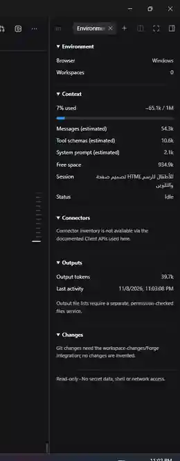

<p align="center">
  
</p>

<h1 align="center">ABINADWAN Plugins Suite</h1>

<p align="center">A modular, open-source toolkit for <a href="https://github.com/deepseek-ai/deepseek-harness">DeepSeek Harness</a>.</p>

<p align="center">
  <a href="https://github.com/abinadwan/DSH-ABINADWAN-Plugins-Suite/actions/workflows/test.yml"></a>
  
  <a href="LICENSE"></a>
</p>

## Overview

One installation supplies three independently toggleable DSH Components. The package card uses the approved Saudi developer avatar. Each Component resolves its own title and transparent icon.

| Component | Delivered in 0.6.0 | Default | Documentation |
| --- | --- | --- | --- |
|  **Environment & Context** | Read-only session inspector | On | [Plugin details](plugins/environment-context/README.md) |
|  **Humanizer** | Runtime writing Skill | On | [Usage and scope](plugins/humanizer/README.md) |
|  **Personal Profile** | Local native settings candidate | Host Off | [Local settings and acceptance](plugins/personal-profile/README.md) |

## Personal Profile (0.7.0 candidate)

Optional preferred name, nationality and gender; local Agent Instructions with personality, response language, characteristics, presets and custom text. Explicit Save uses the native Harness settings service with a revision check. Global within the active Profile; override by real Workspace. No plugin-specific encryption; avoid sensitive information. Access and cloud switches are saved policy preferences only: agent disclosure is not implemented. See [design and acceptance](docs/PERSONAL_PROFILE_LOCAL_SETTINGS.md).

## Environment & Context

The native right-side session inspector opens once when a session becomes visible and can be reopened from the conversation header.

- **Environment** displays browser platform and associated workspaces.
- **Context** displays reported context pressure, estimated message/tool/system-token categories and free capacity.
- **Outputs** displays reported output tokens and latest session activity.
- **Connectors & Changes** display availability notices for integrations awaiting an authorized provider.

The categories are estimates. Use provider billing records for billing totals.

<p align="center">
  <a href="docs/assets/environment-project.webp"></a>
  <a href="docs/assets/environment-session.webp"></a>
</p>

These existing screenshots illustrate the inspector. Component artwork is shown in the table above.

## Humanizer

Enabling Humanizer registers **abinadwan-humanizer** in DSH's runtime Skill registry. It helps the agent edit supplied prose for clarity, natural phrasing, tone and language while preserving meaning, facts, citations and uncertainty. The skill uses original MIT-licensed instructions written for this suite.

Ask the agent to use Humanizer and supply the text, audience and desired tone. For example, “Use Humanizer to make this email concise and professional while preserving every fact.” Arabic requests and requested dialects are supported by the instructions. Results depend on the selected model. Disabling the Component removes the skill from future discovery and loading. Content already loaded into a conversation remains in that conversation's context.

The skill runs when the agent loads it through DSH. Automatic response interception, persistent tone controls and background rewriting remain future work. Its instructions prohibit optimizing for detector scores, promising detection evasion or falsely claiming human authorship.


## Installation and updates

Use the profile actually run by Harness Desktop. For the `desktop` profile, run in PowerShell.

```powershell
# If the legacy package is still installed
dsh plugin --profile desktop remove @abinadwan/environment-sidebar

# Install from the verified SHA of a published stable release.
# Replace RELEASE_COMMIT_SHA with the full 40-character SHA before running.
dsh plugin --profile desktop add github:abinadwan/DSH-ABINADWAN-Plugins-Suite#RELEASE_COMMIT_SHA
dsh --profile desktop --dump-config
```

Restart Harness completely, open **Plugins → ABINADWAN Plugins Suite**, enable the suite and inspect its three Components. Toggle each independently. Personal Profile starts off. When enabled, open its native left-sidebar settings page. Open a normal conversation for Environment & Context and ask the agent to use Humanizer for an editing task.

If your active profile is `web` or another name, substitute that name in every command. Upgrading from 0.4.0 keeps the `abinadwan-suite` group identity and the current inspector behavior. Existing user-layer disable overrides remain applicable. The package ships ready-to-run JavaScript and installs directly from GitHub. No build step is required. An immutable version can be installed by appending `#<full-commit-sha>` to the GitHub reference.

The suite detail page includes a **Suite updates (GitHub Releases)** section below the source information. It shows the version the Host reports, the version of the browser module running in the window, the latest stable release, the last check time and the update method the Host reports for this installation. The suite's browser module automatically checks the newest **stable, published GitHub Release** at startup and every 24 hours while active; **Check again** is also available. A published Release is required: merely changing `main/package.json` or opening a PR does **not** make an update available. The read-only GitHub request sends no conversation data, credentials or referrer. If no stable Release exists, the status is **No published stable release yet**.

**Update now** is user-initiated only and asks for **Confirm update** before any Host change. The preview resolves the release tag to an immutable SHA and checks the `package.json` identity and version at that commit. The Harness Host's own `pluginManager.updateBundle` method (the same one the native Plugins update dialog uses) then installs that pinned revision, with its own validation and attempted rollback/restart handling. **There are no silent installations.** The Host may refuse, require a restart or fail to restore the prior installation. Review its Plugins status and keep a tested recovery path.

**Git install prerequisite:** Harness Desktop `v0.2.2-rc.3` reports `update: git` only for a package installed from a Git spec pinned to a **full 40-character SHA**. A legacy `github:abinadwan/DSH-ABINADWAN-Plugins-Suite` install tracking a branch is **not** automatically updatable. That installation must be migrated deliberately to a pinned Git revision first; the suite does not uninstall, replace or reconfigure it on its own. When you press **Update now** on such an installation, the section explains this and shows the verified pinned spec for the release; you can then decide to uninstall and re-add the bundle with that spec yourself. Use the source's documented install/remove workflow only after confirming the active DSH Profile and preserving a known-good SHA. A published stable GitHub Release must precede any installable update offer.

## Architecture and compatibility

The bundle patch declares the package-root Cordis Group containing Environment and Humanizer, and an independent settings-owned Personal Profile row directly under the profile Include. DSH omits Group containers from the Components list. Subpath locale and icon exports give the rows their own identities. The package-root browser carrier remains available for suite controls and watches access-checked Host inventory to mount the Environment and Profile browser fibers. This follows the current DSH contract, where browser bundle discovery uses package-root entries. [DSH metadata contract](https://github.com/deepseek-ai/deepseek-harness/blob/39163dd30f703a79079e2d2446545cff3c453738/docs/cookbook/adding-a-package.md#plugin-display-metadata)

Humanizer uses `ctx.skills.register()`. Environment uses the native right-sidebar, conversation-header and session projection APIs. The UI follows `plugin-manager/changed` and `connection/reset`, disposes resources when a Component or access is disabled, and ignores stale inventory responses. An inventory read failure pauses Component UI until a successful refresh. The suite requires a DSH profile with Skills, Plugin Manager, Remote access and the standard web conversation/sidebar services.

## Development and verification

```sh
npm ci --ignore-scripts
npm test
npm run check:package
```

Tests use the actual Cordis Loader, DSH metadata reader and Skill registry, plus controlled browser-service fixtures and real React rendering. The package check extracts an npm tarball and runs the same tests against its contents. CI runs these checks on Windows and Linux with Node 22 and 24. DSH test libraries are locked at 0.2.2-rc.3. A separate local installation/configuration smoke check used DSH CLI 0.2.1-rc.5. Visual Desktop interaction and model-produced rewrites still require validation on the user's running Harness/model combination.

## Privacy and security

Environment reads UI-facing session/workspace summaries and projected token usage. The runtime Humanizer instructions operate within DSH's existing model context. Text supplied to the agent follows the user's existing model/provider configuration. The suite adds no external rewriting endpoint. The read-only automatic/manual release checks contact public GitHub without credentials, referrers or conversation data. Installations require an explicit user confirmation and are delegated to the official DSH Host. Personal Profile stores the reduced optional profile fields and preferences in the active Harness Profile without plugin-level encryption; it does not transmit them to a model. [Security policy](SECURITY.md)

## License and attribution

MIT License. The Humanizer instructions are original to this suite. Artwork uses the four approved user-supplied PNGs, resized with transparency retained for DSH's image-size limit. [License](LICENSE) · [Artwork provenance](docs/BRANDING.md)

This independent community project is unaffiliated with DeepSeek or Anthropic. DeepSeek Harness and Claude Code remain trademarks of their respective owners.
