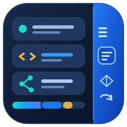

<p align="center">
  
</p>

<h1 align="center">Environment & Context</h1>

<p align="center">
  A native, read-only session inspector for <a href="https://github.com/deepseek-ai/deepseek-harness">DeepSeek Harness</a>.
  <br>
  Workspace state, context usage and agent activity—without leaving your conversation.
</p>

<p align="center">
  <a href="https://github.com/abinadwan/deepseek-harness-environment-sidebar/actions/workflows/test.yml"></a>
  
  
  
</p>

<p align="center">
  <a href="#features">Features</a> ·
  <a href="#installation">Installation</a> ·
  <a href="#how-it-works">How it works</a> ·
  <a href="#troubleshooting">Troubleshooting</a> ·
  <a href="#limitations">Limitations</a>
</p>

---

## Overview

**Environment & Context** adds an inspector tab to the native **right-hand sidebar** in DeepSeek Harness. It opens when a foreground conversation session is shown for the first time and can be opened again from the conversation header or the sidebar's page picker.

It is inspired by the information architecture of modern coding-agent dashboards, but the implementation is independent. It does **not** use Claude Code internals or claim complete feature parity.

## Features

| Section | What it displays | Data status |
| --- | --- | --- |
| **Environment** | Browser platform and linked workspace names/paths | Available when the workspace is registered |
| **Context** | Context occupancy, context capacity and available token usage | Model-reported occupancy; breakdown is estimated |
| **Connectors** | Clear notice when a connector inventory cannot be obtained | Not yet integrated |
| **Outputs** | Model output token total and last activity | Available if session projections report them; file list not included |
| **Changes** | Clear notice that Git change information needs a separate integration | Not yet integrated |

**Context detail:** `contextPressure` supplies model-reported pressure/capacity when available. `contextBreakdown` supplies *heuristic* message, tool-schema and system-prompt buckets; these may not sum exactly to the pressure value and are **not** the detailed breakdown shown in Claude Code.

**Privacy by design:** no network calls, credential harvesting, local shell commands or filesystem reads are added by this plugin.

## Installation

### Desktop — GitHub source

1. Open **Plugins** in DeepSeek Harness and remove an older `@yourname/environment-sidebar` package if it is still installed.
2. In PowerShell, install the package into the profile your Desktop app actually uses:

```powershell
dsh plugin --profile desktop add github:abinadwan/deepseek-harness-environment-sidebar
```

3. Completely restart Desktop after replacing an installed version.
4. Open a **conversation session** (the inspector is session-scoped, so it does not appear on the global Plugins page).
5. Look for the **Environment** tab in the right sidebar or use the button in the conversation header.

To verify the profile configuration:

```powershell
dsh --profile desktop --dump-config
```

To **update** an existing installation:

```powershell
dsh plugin --profile desktop remove @abinadwan/environment-sidebar
dsh plugin --profile desktop add github:abinadwan/deepseek-harness-environment-sidebar
```

You can append `#<full-commit-sha>` to the GitHub reference to pin a reproducible revision. The package includes ready-to-run Host and browser files; it is **not** published to npm.

### Install from a local clone

```powershell
git clone https://github.com/abinadwan/deepseek-harness-environment-sidebar.git
dsh plugin --profile desktop add "./deepseek-harness-environment-sidebar"
```

Run the second command from the parent directory of the cloned repository.

## How it works

The plugin uses DeepSeek Harness extension points rather than modifying application source:

- `ctx.sidebarRightTabs.register(...)` creates a native right-sidebar page type.
- `sidebar.right.pane.tab` renders the session-specific inspector.
- `conversation.session.header.utilities` registers an entry point to reopen the inspector.
- `ctx.sidebarRight.mounted` identifies the visible session; the inspector opens once per session.
- `sessions.list` and `workspaces.list` provide session/workspace summaries.
- `useProjection('contextPressure' | 'contextBreakdown' | 'tokenUsage')` provides available token information.

The Host entry is intentionally minimal. `client.js` is a shipped browser module and does not require an install-time build step.

## Compatibility and testing

| Check | Status |
| --- | --- |
| Source manifest, Host entry and browser module tests | Covered by GitHub Actions |
| Native tab and header-action registration smoke tests | Covered by GitHub Actions |
| Safety-oriented static checks | Covered by GitHub Actions |
| Real Desktop UI rendering on your installed DSH version | **Not yet independently verified** |
| Exact compatibility across DSH releases | **Not established** |

Current release: **v0.2.1 (experimental)**. The extension follows the documented right-sidebar/Client-module patterns of contemporary DeepSeek Harness builds, but its functionality still depends on the version and profile installed on the user's machine.

```bash
npm test
```

## Troubleshooting

**Plugin installed, but no sidebar appears**

- Check **Plugins → Environment & context** and verify both bundle and component are enabled and the component is **Running**.
- Check that Desktop and the installation command use the **same profile**. `desktop` and `web` are separate.
- Open an actual conversation **Session**; global pages do not mount the session sidebar.
- Restart Desktop fully after replacing a package.
- Inspect Developer Tools for `client.js` loader errors, failed dependency injection, or missing slot registrations.

**Context values show “Unavailable” or a dash**

The active model may not have reported a context window or usage yet, or the relevant projection may not be available in the running DSH version. Missing data is never synthesized.

**The older left-navigation page is still visible**

Uninstall the prior `@yourname/environment-sidebar` build separately. v0.2.x uses the right-hand sidebar.

Please open a [bug report](https://github.com/abinadwan/deepseek-harness-environment-sidebar/issues) with your DSH version, profile, the component status and relevant console error (remove any secrets first).

## Limitations

This is **not** a full Claude Code sidebar replica. At present it does not provide separate MCP tool, skill and custom-agent token counts; connector inventories; output-file browsing; Git change summaries; PR actions; or a compact-session button. Those features require explicit, permission-checked integrations and should not be inferred from unrelated state.

## Project information

- **Package:** `@abinadwan/environment-sidebar`
- **Current version:** `0.2.1`
- **Distribution:** GitHub source (not npm)
- **Logo:** original [SVG icon](icon.svg) with [brand notes](docs/BRANDING.md)
- **Security:** [SECURITY.md](SECURITY.md)
- **Contribution guide:** [CONTRIBUTING.md](CONTRIBUTING.md)
- **Changelog:** [CHANGELOG.md](CHANGELOG.md)

### License and attribution

**No open-source license has been selected yet.** Unless and until the repository owner adds a `LICENSE` file, public visibility alone does not grant permission to redistribute or modify this project's code. See [Contributing](CONTRIBUTING.md) for how to propose changes.

DeepSeek Harness and Claude Code are trademarks/products of their respective owners. This is an **unofficial community extension** and is not affiliated with, sponsored by or endorsed by DeepSeek, Anthropic or OpenAI. No proprietary source code was copied from those products. Extension contracts are based on the [DeepSeek Harness](https://github.com/deepseek-ai/deepseek-harness) public documentation.
