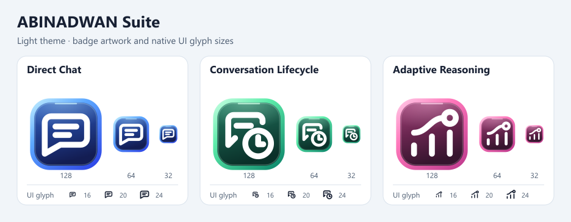
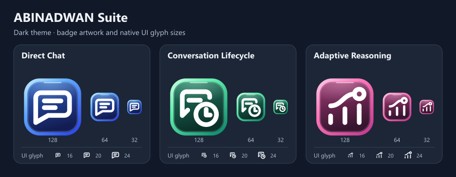

# New plugin artwork

Direct Chat, Conversation Lifecycle, and Adaptive Reasoning use the same badge geometry, gloss, and 24 × 24 glyph grid as the other three components. See the [suite artwork index](BRANDING.md) for all six identities and shipped paths.

| Plugin | Symbol | Badge SVG | Native glyph SVG |
| --- | --- | --- | --- |
| Direct Chat | Speech bubble with two reply lines | [Badge](../plugins/direct-chat/assets/icon.svg) | [Glyph](../plugins/direct-chat/assets/glyph.svg) |
| Conversation Lifecycle (Chat Control) | Speech bubble and clock | [Badge](../plugins/conversation-lifecycle/assets/icon.svg) | [Glyph](../plugins/conversation-lifecycle/assets/glyph.svg) |
| Adaptive Reasoning | Rising bars and trend line | [Badge](../plugins/adaptive-reasoning/assets/icon.svg) | [Glyph](../plugins/adaptive-reasoning/assets/glyph.svg) |





The sheets use simulated theme surfaces. Native controls use `currentColor` so the host can apply its text color, and the controls provide their own accessible labels.

## Regenerate or verify artwork

Edit the plugin glyph paths, palettes, and shared badge geometry in [the renderer](../scripts/render-plugin-icons.mjs). It writes all six SVG badge and glyph pairs, 30 PNG variants, the three compatible root PNGs, both contact sheets, and the native glyph geometry in `client.js`.

Use Windows with Segoe UI for byte-for-byte reproduction of the contact sheets. The renderer uses Sharp 0.35.5 and librsvg 2.63.2. Run these PowerShell commands from the repository root with the matching DeepSeek Harness Desktop runtime installed.

```powershell
$fixture = node qa/extract-new-plugins-runtime.mjs 'C:\Users\Admin\AppData\Local\Programs\DeepSeek Harness\resources\app.asar' | ConvertFrom-Json
node scripts/render-plugin-icons.mjs $fixture.scratch
node scripts/render-plugin-icons.mjs $fixture.scratch --check
```

The final command verifies that the generated files and native glyphs match the renderer. The renderer and its dependencies are used during development.