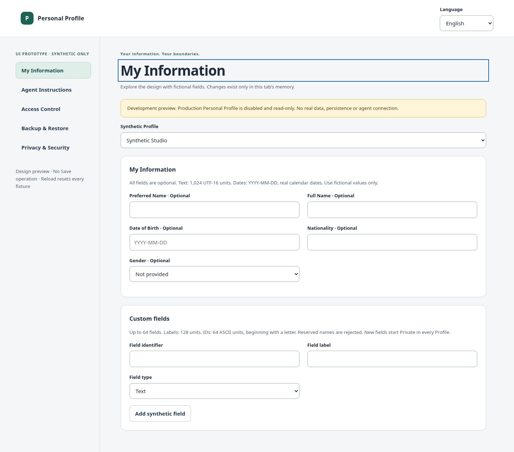
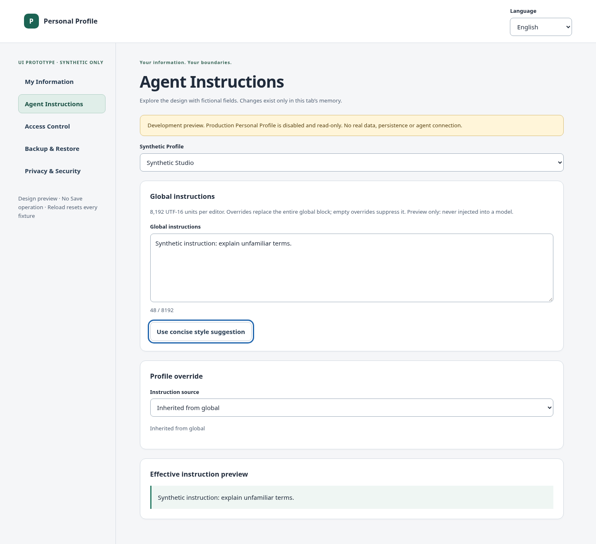
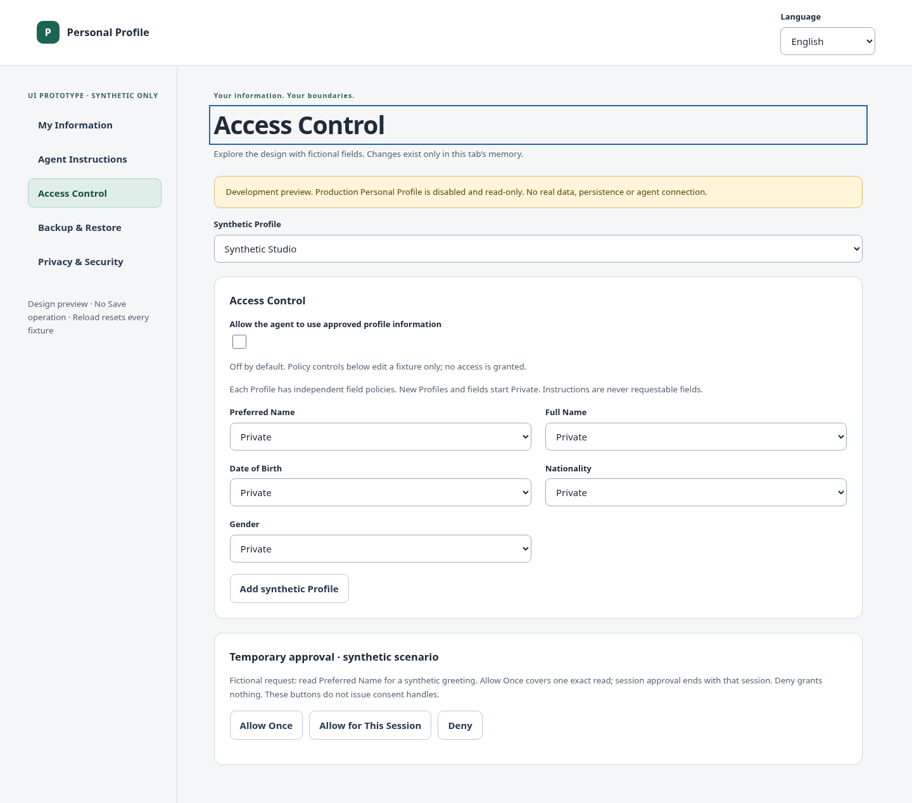
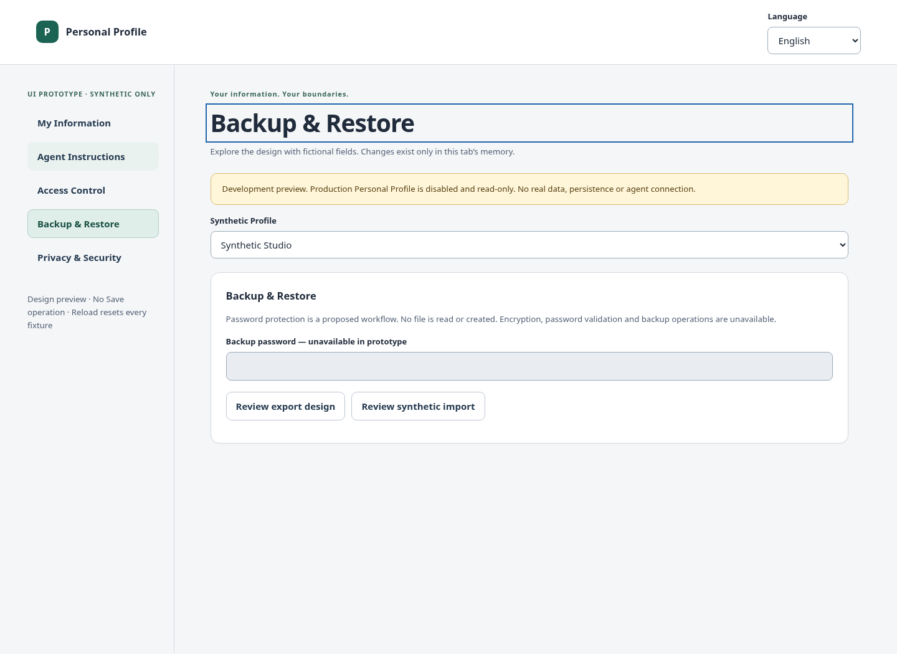
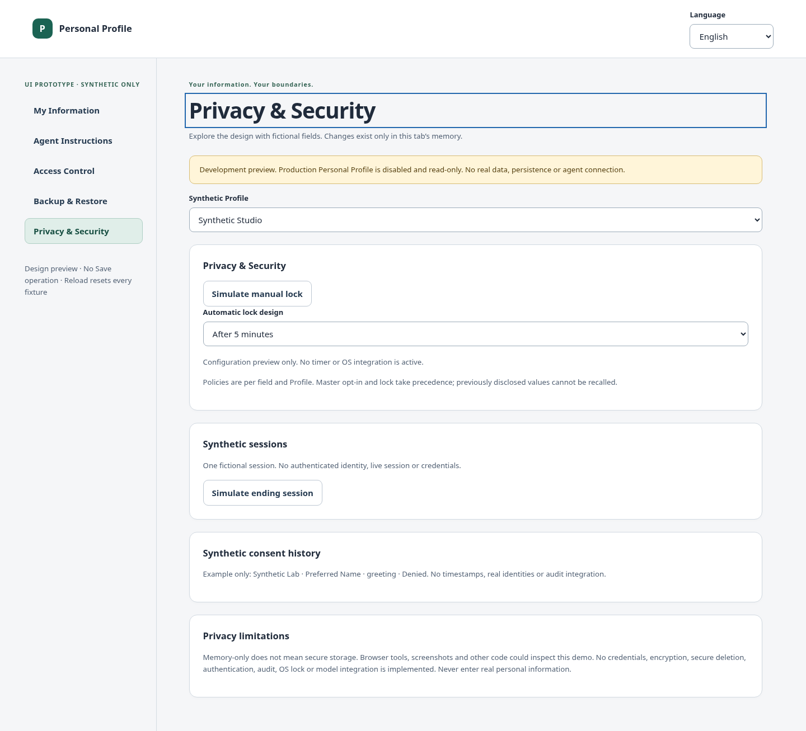
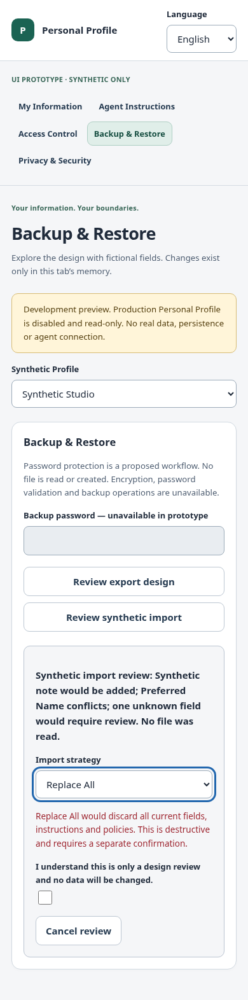
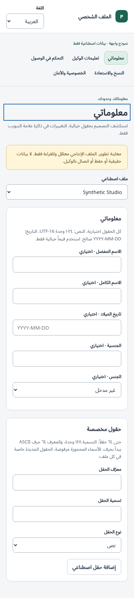

# Personal Profile — Phase 4 UI prototype

> **Superseded (historical record).** Version 0.7.0 replaced this design with native Harness settings; see [the current design](PERSONAL_PROFILE_LOCAL_SETTINGS.md). Nothing described here is in the runtime or the package.

This development/test-only prototype implements five navigable pages using
synthetic, disposable fixture state. The production Host remains disabled and
read-only. `client.js`, `index.js`, the patch, all Phase 1–3 engine modules and
package exports are unchanged. Nothing is mounted in Harness.

## Preview

From a checkout, run `node scripts/preview-personal-profile.mjs` and open
<http://127.0.0.1:4174/test-support/personal-profile-ui/index.html>.
Stop with Ctrl+C. It binds only to loopback and serves an exact allowlist: six UI
files plus the existing pure schema/limit modules. It denies all engine and
runtime endpoints. CSP disallows connections, forms, frames and external assets.
The static resources must load locally; the UI itself performs no network calls.
There are no third-party UI libraries, fonts, analytics or hosted assets.

The preview and server are excluded from the production package (`test-support`
and development scripts are not in `files`). The package checker rejects all
`test-support/` files and all `scripts/` files except the exact approved security
probe path `scripts/personal-profile-windows-probe.mjs`. Security PR #2 intentionally
packages that opt-in Windows DPAPI verification tool. This compatibility exception
does not add the probe file or change Phase 4’s package file list; it takes effect
only when that security work is integrated. No nested paths, filename variants,
suffixes or other scripts are allowed. In particular,
`scripts/preview-personal-profile.mjs` remains forbidden. For artifact verification only, the existing check
copies tests and
test-support into its temporary extraction after packing.

## Pages and behavior

- **My Information:** all five built-ins optional; custom field add, label/value
  edit and remove; text, finite number, boolean and calendar date types. Missing
  values differ from false, zero and unspecified Gender. Reuses Phase 1 pure
  validators and budgets (UTF-16 units); errors do not echo rejected values or
  change the previous valid fixture. Edits update the in-memory fixture while typing, without a Save operation.
- **Agent Instructions:** global editor, per-synthetic-Profile replacement, absence
  restoring inheritance and explicitly empty overrides. Effective preview is inert.
  Suggestions are optional and require a click. No model composition/injection.
- **Access Control:** master switch starts off. Private/Ask First/Allow selectors
  are independent per field and Profile, including newly added synthetic Profiles.
  Implicit missing policies represent Private. Allow Once, Allow for This Session
  and Deny demonstrate choices only, never real grants or handles.
- **Backup & Restore:** disabled password field, export warnings, synthetic import
  review, Review & Merge and destructive Replace All states, acknowledgement and
  disabled final action. No file picker, download, password handling, crypto,
  import parsing, conflict resolution or operation-success confirmation exists.
- **Privacy & Security:** simulated manual lock hides editors; reset returns to
  the same synthetic state without claiming authentication. Automatic-lock selector
  has no timer. Fictional session termination and consent history are presentation
  only. No identity, credential, audit or OS integration.

English and Arabic catalogs share every message key. The language selector sets
`lang` and `dir`, using logical CSS and automatic direction for entered text.
Native labelled controls, headings, navigation current-state, skip link, error
associations, focus restoration and visible focus support keyboard access. Two
columns collapse to one on small screens. Locale selection is memory-only.

## Future authenticated Host-to-UI boundary — not implemented

The fixture model is not a second profile engine or a proposed public API. No
management factory, private instructions, personal values or consent capability
is imported from the real engine, serialized, or exposed to a live browser.
Only the pure Phase 1 schema/limits are shared. All preview text originates from
synthetic constants or the person operating this isolated demo.

Before real integration, separately review an authenticated management transport:
Host-owned user authentication and authorization; trusted canonical active Profile
resolution; minimal view-specific data; operation-specific authorization; lifecycle
and lock checks at every read/write; approval routing bound to caller, Profile,
session, field, purpose and expiry. Keep opaque capabilities and canonical identity
resolution inside the Host. Browser-supplied names or IDs must never become proof
of authorization. Define request forgery protection, transport origin restrictions,
revocation, stale-view handling, error/log privacy and failure behavior before
implementing endpoints. The prototype deliberately supplies no such bridge.

Instruction preview/edit authorization is separate from personal-field opt-in.
Neither consent nor preview authorizes model injection. Future persistence,
password backup formats, key management, secure lock and model composition require
separate designs and review. Memory is inspectable by browser tools/other code;
no secure erasure is claimed. Never enter real personal data in this prototype.

## Verification and visual evidence

- `npm test`: 98 tests passing, including eleven new component/navigation/state,
  validation, English/Arabic axe DOM and isolation tests.
- `npm run check:package`: same 98 tests passing against extracted package code;
  development UI/server exclusion checked before test-support is copied in.
- Package-policy regression tests reject preview scripts, test-support assets,
  arbitrary scripts and near-match probe paths; accept the exact approved probe;
  and validate the actual `npm pack --dry-run` list against the current manifest.
  This runs on both source and extracted-package checks and does not execute the
  Windows probe. Future integration must still review PR #2’s probe/dependencies
  and run its separate Windows security checks; an allowlisted path is not a
  security assessment of its contents.
- Chromium: desktop 1440px and mobile 390px, five pages with no horizontal overflow;
  keyboard skip-link/content focus; axe including color contrast on all English
  pages and Arabic information page; no script errors or external requests.
  The server denied runtime, consent-engine, manifest and traversal requests.
- JSDOM axe tests cover both languages on all pages; color contrast is disabled
  only in JSDOM because it has no layout/canvas. Native control/keyboard behavior
  was additionally checked in Chromium. Automated checks do not replace a full
  assistive-technology/user review or cross-browser testing.
- Existing unchanged Actions runs both required commands on Ubuntu/Windows,
  Node 22/24. The PR's check results are the source of truth for remote CI.

Screenshots contain only empty fields and explicitly synthetic examples:

