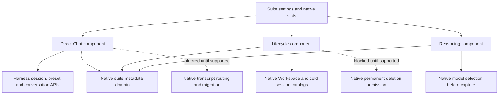

# Direct Chat, Conversation Lifecycle and Adaptive Reasoning — Phase B design

> **Historical Phase B specification.** The approved plan evolved: today's Direct Chat uses one shared Workspace with native Sessions and Host tool guards; Chat Control provides retention preview without deletion; Adaptive Reasoning supports manual effort, not automatic/message-only effort. See [current DETAIL](../../../DETAIL.md).

Status: **Conditionally approved for gated Phase C on 2026-11-19**. Baseline `feature/new-plugins` / `2c475f9`, suite `0.8.0-rc.1`. The owner approved the native architecture, separate plugins, shared domain, Settings and icon concepts, subject to the safe deletion, retention, storage and reasoning amendments below. See the [discovery and SDK evidence](../../../research/NEW_PLUGINS_PHASE_A.md), [roadmap](../plans/2026-11-18-new-plugins.md) and [Phase C capability update](../../research/NEW_PLUGINS_PHASE_C.md).

## Intent and constraints

Deliver three independently enabled suite components over Harness's native session engine. Direct Chat removes manual Workspace setup. Conversation Lifecycle manages only Workspace conversation records. Adaptive Reasoning controls real supported provider effort. Keep the existing suite carrier, identities, user overrides, Arabic/English localization, RTL/LTR and native light/dark behavior.

No Harness core edits, client bundle rewriting, competing-source copying, extra backup/encryption, Temporary Chat, cloud synchronization, recycle bin, AI deletion choices, workspace-directory deletion, or publication. Do not change Personal Profile implementation/assets or Phase 7D files while its separate work is active. Profile Settings integration is a separately coordinated future change.

The owner approved independent safe deletion feasibility work using verified Harness contracts and synthetic sessions. Production filesystem deletion and private API alternatives require proof of the safety guarantees and separate approval. Shared suite files require coordination with the concurrent Profile work before editing.

## Approaches

| Approach | Tradeoff | Decision proposed |
|---|---|---|
| Native session/UI + suite-owned sidecar metadata + supported services | Fits existing suite, keeps native history/model/upload behavior and clean data ownership; advanced features must wait for missing Host contracts | **Recommend** |
| Managed hidden/visible Chat Workspace | Less custom navigation but conflates Workspace and Direct Chat ownership; cwd and storage still differ; default Workspace tools risk overbroad access | Reject for this brief |
| Custom chat engine, patched native bundle, raw log cleanup or adapter rewriting | Apparent access to more controls, but duplicates core ownership and bypasses lifecycle/permission/version guarantees | Reject |

## Boundaries and invariants

1. **Harness owns transcripts, session IDs, streams, model routes, attachment objects and persistence writers.** The suite never maintains a second transcript or rewrites log generations.
2. **Direct Chat ownership is explicit and durable.** Neither cwd nor absence of Workspace membership proves ownership. Lifecycle deletion never includes an owned Direct Chat, even after its component is disabled or a session is mistakenly attached to a Workspace.
3. **Workspace scope is positive membership.** Orphans, corrupt/missing metadata, ambiguous ownership, incomplete catalog results and inaccessible sessions are excluded and reported. “All Workspaces” means this active Host/Profile and principal's authorized inventory, not unrelated Profiles or remote Hosts.
4. **The Host enforces every write.** UI state, supplied IDs, confirmation text and caller paths cannot grant authority. No model-facing management tools for deletion, migration or settings are added.
5. **Running/active sessions are excluded, never stopped to enable deletion.** Conservatively, active includes a resident Agent or a conversation open/retained in a client, not merely a currently streaming turn. The future native deletion boundary must hold activity/writer/activation/open-view exclusion through commit. An idle check followed by filesystem deletion is insufficient. If the Host cannot authoritatively track open views, that acceptance remains blocked; browser-local `retainedBy` is not a global lease.
6. **Effort is selected before the loop captures it.** A prepared step and its retries retain their choice. No prompt instruction pretends to be an effort control.
7. **Unavailable means unavailable.** No fake zero-byte statistics, guessed support, empty-success inventory, silent downgrade or success toast for blocked work.



## Shared data and interfaces

Use native Settings for user preferences; each new component gets a stable, uniquely addressed top-level row (`abinadwan-direct-chat`, `abinadwan-conversation-lifecycle`, `abinadwan-adaptive-reasoning`) with volatile validated config and revision-checked writes. New components start disabled pending deliberate enablement. Preserve all existing row IDs and root Group behavior. Do not add a new suite-wide configuration blob containing Profile data.

Use one native `storageDomain` domain named `abinadwan_conversations`, version 1, for sidecar metadata only. Installed Harness requires snake-case domain names. A small shared module owns its schema and reference-counted acquisition keyed to the actual Host `storageDomain` service. All three components use the same opener and close the handle only when the final consumer releases it. Native domains reject a second open of the same name in one facility. Prove the lifetime against real Cordis/domain services before adoption. A failed or unknown domain state pauses writes and cleanup until reopen. Use this design only where coherent ownership across Host processes is established or the deployment guarantees a single Host writer.

Suggested records:

| Table | Owner and fields | Invariant |
|---|---|---|
| `directChats` keyed by native session ID | Direct Chat: schema version, `pending`/`ready`, created time, preset ID | No transcript, PII, provider credential or host path; immutable category once ready |
| `protectedSessions` keyed by session ID | Lifecycle: protected flag and change time | Automatic eligibility excludes protected IDs; stale rows do not imply a transcript exists |
| `reasoningSessions` keyed by session ID | Reasoning: policy/override kind, provider+model identity, selected effort, policy generation | Distinguishes user override from policy output; no task text retained |

Workspace retention overrides belong in Lifecycle Settings keyed by native Workspace ID, not in project folders. Policies keep old/unknown IDs inert until the Workspace is known. Domain writes are durable and serialized but not cross-table transactions; do not claim atomic session creation + ownership insertion.

Proposed internal interfaces (suite-owned, **not existing Harness APIs**):

```text
acquireConversationData(ctx) -> Promise<{data, release(): Promise<void>}>
classifySession(id, catalog, data) -> direct | workspace(workspaceIds) | unknown
planCleanup(scope, policy, catalog, now) -> immutable Preview
resolveEffort(modelInfo, tierMap, policy, inputFacts) -> explicit(id) | adapterDefault | unavailable(reason)
```

`Preview` carries operation ID, Host/Profile identity, authorized scope, policy version, per-ID storage/activity/ownership revisions where available, candidate/excluded reasons, optional measured bytes and completeness. The future execution API returns per-ID deleted/skipped/failed/unknown outcomes; an interrupted operation is never reported as complete. Do not create a generic service framework or swappable fake deletion provider while the native operation is absent.

New suite RPCs must use the native authenticated Typert/connection extension path with explicit resource resolution and `remoteAccess` checks. Owner-authorized settings/creation/preview mutations do not imply model-call authority or a global role for other principals. Confirmation is bound server-side to principal, Host/Profile, connection generation, exact candidate set and revision fingerprint; never accept a client boolean as deletion approval. No raw unauthenticated HTTP route or arbitrary host path parameter is needed.

## Native Settings integration

One effect-owned `settings.section` contribution: id `abinadwan-suite`, label “ABINADWAN Suite” / Arabic equivalent, localized icon and order. Native `settings.section.icon` is available in the installed shell. The browser coordinator extends the existing generation-checked inventory lifecycle and starts each new UI module only while its Host row is both enabled and active and required access is available.

Each feature exports its own settings panel and lifetime-owned registration; a small roster displays only available/enabled features. No Profile placeholder tab now. Its current sidebar entry, settings owner and runtime contribution stay unchanged. Future Profile tab requires its owner to expose a supported panel integration after concurrent work; it is not created by importing private Profile functions or moving its config.

On disable, access revocation, disconnect or failed inventory, withdraw dependent tabs/actions, cancel pending previews/writes, and ignore stale async results. Return focus to an available tab or the native settings shell. Dirty drafts need an explicit discard/reload choice; failed/conflicting saves remain visible and never look persisted.

Add session-row “Delete Chat” and Workspace “Delete All Chats” through native `contextMenus.register` targets. An optional Session-header action is a separate `sessionHeader` target. Every action opens the same preview/confirmation page, scopes through Host identity, and stays disabled with a clear unsupported reason while B1 remains unresolved. Never call `workspace.delete` or change the existing Workspace delete action.

## Direct Chat

### Creation and list

New Chat reserves a server-generated native session ID by durably writing `directChats[id]=pending`, then creates through the supported Session Controller with explicit suite preset and a managed execution cwd, omitting `workspaceId`. It uses the response's actual ID, verifies it is the reserved new session, and durably marks it ready **before** exposing it for sending. Never pass a previous blank ID for reuse. On mismatch or crash, keep all reservation/actual-ID evidence and refuse sending; reconcile only from authoritative session/preset observations. Do not delete an uncertain orphan as rollback.

Ownership classification also reads the native recorded preset through authoritative Session observations. Any suite Direct-preset session missing a matching ready ownership row is quarantined as unknown and excluded from Lifecycle, even if attached to a Workspace. Pending reservations and preset/ledger mismatches are never treated as ordinary Workspace chats. If preset observations/catalog completeness are unavailable while reconciling reservations, pause destructive cleanup. This covers a crash after native creation minted a different actual ID but before the suite recorded that response; reservation ID matching alone is insufficient. Never write experimental plugin log records as a replacement marker.

The client shows only ready owned sessions plus an explicit recovery notice for pending creations. Query native titles/activity and bind the native Session to the embedded `conversation.content` Factory/Chat target. Use native navigation/Slot services, not synthetic Workspace records, method replacement, DOM observers or selector-based placement. Independent list filtering is positive ownership filtering. Where the global native catalog also exposes workspace-free sessions, do not suppress other plugins' entries by rewriting that catalog.

The managed cwd is an execution staging directory under the actual native active data context; it is **not** a user-selected transcript location or a security sandbox. No home-directory fallback. Directory creation is constrained Host bookkeeping, never a model filesystem grant. Prove preset selection/resume behavior before choosing its final native declaration.

### Permissions and attachments

Dedicated native preset includes only the tools required for chat, authorized web search/fetch and a verified attachment-only reader. Use native executor, restrictive composition and a monotonic scoped guard. Do not expose terminal, arbitrary filesystem read/write/search, cwd switching, plugin/config editing, MCP registration, arbitrary code executors, jobs/workflows, browser automation or delegation by default. An allow-list of names alone cannot authorize a newly shadowed registration; bind permitted tool definitions and exact Agent scope. Verify resumed sessions, preset changes and invocation paths as well as displayed schemas. Fail closed if the restrictions cannot be installed.

Retain native streaming, Markdown/code rendering, image validation, pending-send/draft recovery and model selection. Generic file reads use an opaque attachment ID, checked against that exact session's admitted native references before `attachments.readFileStream`; never accept an arbitrary path or trust a browser's list of attachments. Stream with bounded output and cancellation; binary/unsupported extraction reports its limitation. A shared native attachment ref may be readable by the store without session authority, so membership validation must be the suite's boundary.

The native Windows path bridge can turn selected files into `@path` chips requiring broad file tools. That behavior is unsuitable for restricted Direct Chat. Require a supported upload-only intake configuration/extension and native opaque receipts for generic files; until proved, generic file UX is blocked, not implemented through broad file access. Image-only success does not meet the full attachment requirement.

Profile integration reuses its existing committed preference/custom-text consent behavior where the native preset admits that contribution. Do not add a second injector, read/export its structured fields or treat saved Allow as an effective disclosure grant. If a Direct Chat-specific Profile opt-out cannot be enforced without Profile changes, expose that limitation and coordinate later; do not invent a toggle that has no effect. Global user-shared instructions/Skills are also not automatically safe to load into a cloud chat; prove the chosen preset's actual prompt composition and explain its inherited behavior.

### Storage and retention

Initial Direct Chat uses the active native persistence provider. Show its authoritative default storage location when available. The packaged base configuration resolves `dshHomePath('sessions')`. Active overrides may change that root, so display that value as the effective path only when the Host confirms it. `sessionPersistence.stat(id).location` gives an individual materialized artifact path. Use an unavailable state if only that artifact or the packaged default is known and the current effective root cannot be confirmed. Custom transcript location and safe migration remain outstanding under B2. The global root and cwd are outside that feature's ownership.

Retention choices are exactly Keep forever, 365, 180, 90, 30, 7 days; Keep forever proposed initial value. Expiration uses the last native conversation activity, never creation time or filesystem mtime. Validate the catalog's activity semantics; where insufficient, derive from native event history. Policy bookkeeping must not itself refresh conversation activity. Missing/invalid/future timestamps are skipped and reported. Expire at `lastActivityAt + days * 86_400_000 <= now` using UTC elapsed days, not local calendar/DST arithmetic.

Delete All Direct Chats requires an exact-scope preview and explicit irreversible-delete confirmation. The eligible set is the complete ready owned catalog, excluding active/uncertain sessions. Execution remains blocked on B1. Never cascade into Workspace conversations or shared attachments. No extra backup, encryption, temporary mode or sync.

Future native migration must fence new writes, cover all selected native artifacts/index references, verify identity/content, atomically publish location or retain original on failure, survive restart with a resumable journal, and never migrate Workspace sessions. A transient verified copy used for movement is not an ongoing backup feature. No migration scaffolding is authorized before a native contract exists.

## Conversation Lifecycle

Enumerate native Workspace registry membership, archive/pin metadata and cold Session catalog without activating Agents. Include archived conversations by identity, not just visible sidebar rows. De-duplicate sessions in multiple Workspaces. For a per-Workspace deletion, preview other memberships explicitly; never silently remove a shared conversation from other Workspaces. Proposed safe default is to exclude multiply attached sessions until explicitly selected in a preview naming every affected Workspace.

Scopes: one ID, explicit bulk IDs, selected Workspace, all authorized Workspaces. Revalidate every submitted ID on the Host. Direct Chat and unknown ownership are always excluded. Subagent records and ordinary forks are distinct: no implicit parentSession cascade. The safe first behavior is exact selected conversation IDs; a parent with managed children/dependencies is blocked unless native deletion defines safe referential handling. “Delete all” reports unhandled descendants/relationships rather than claiming complete removal.

Global retention uses the same choices/time rule as Direct Chat. A Workspace override can inherit global, Keep forever, or use one listed duration. If a conversation has several Workspace policies, Keep forever wins, otherwise use the longest duration. A protected conversation is excluded from retention planning; manually deleting it requires a separate acknowledgement in the exact preview. Protection alone does not allow deletion of active/Direct Chat/unknown sessions.

Use Keep forever by default for each retention policy. Before enabling or changing an automatic policy, show a current preview and require informed confirmation of its scope, retention age, exclusions, and irreversible future deletions. Record consent with the exact policy revision. Once the safe engine is approved and the current policy is explicitly confirmed for automatic execution, an effect-owned Host timer can clean up on startup and daily while running without repeated daily confirmation. A preview-only setting does not authorize later activation after an upgrade. Manual deletions still require their own explicit confirmation. Until safe execution is established, label retention preview-only and produce no automatic deletions.

For manual confirmation, validate the principal, access, connection generation, policy and candidate fingerprint. For each automatic run, validate the confirmed policy revision and current authority. In both cases re-read ownership, protection, activity and storage revisions under the deletion engine's admission fence. Manual changes to candidates require a refreshed preview. Automatic runs skip ineligible IDs and report outcomes. A native transaction or an independently verified and separately approved engine must hold exclusion through commit and recovery. Skip active turns, approvals, jobs, reminders and descendants. Disable prevents new work and follows the engine's documented recovery semantics for work already admitted.

Counts are authorized known conversations, split active/archived/Direct Chat/excluded. Usage labels distinguish selected-log bytes, unmeasured sessions, retained generations, shared attachments and other storage. Sum only measured values; report partial coverage. Never label selected-generation byte sums as exact disk usage or promised reclaimed bytes. Attachments are immutable and shared, and the installed provider retains them indefinitely: even native log deletion would not imply full erasure or recovery of those bytes.

Results list deleted, skipped (reason), failed and unknown. No recycle bin and no plugin recovery copies. Confirmation explains permanent history deletion and remaining native/shared objects. A browser closure or network timeout cannot be translated to success; reconcile the operation ID with native outcome when supported.

## Adaptive Reasoning

### Reuse and capability model

The installed native composer already exposes model-supported effort. Keep that manual selection UI as the authority; a new small adjacent policy control may expose Adaptive/session/next-message scope only when the corresponding Host capability is supported. Do not replace `conversation.input.model` or add duplicate manual ladders.

Key configuration by provider ID + exact model ID, with advertised effort ID/name/description, optional adapter default, and a validated user/adapter tier mapping. Effort IDs are opaque. Never assume `off`, `none`, `low`, `medium`, `high`, `max`, numeric budgets or advertised array order have universal semantics. Unknown model or missing mapping keeps native manual choices and Adapter default; automatic policy is unavailable with a reason. Do not edit adapter declarations to fabricate support.

The native `model/selection` projection does not record whether a choice came from a user or policy, and selecting the same recorded tuple can be a no-op. It cannot prove manual intent. The suite may provide an explicit **Use current effort for this session** lock action that durably records user override intent. Automatic policy remains disabled unless the supported integration also observes native picker user intent, including unchanged-value choices, before another automatic decision. Do not infer intent from equality/difference or attribute every model-selection event to the user. B3 includes this missing integration; a separate explicit lock does not make native-picker intent detection solved.

| Proposed default | Valid application |
|---|---|
| Direct Chat: Low | Only if exact model mapping establishes a supported low tier; otherwise Adapter default with a visible fallback explanation |
| Workspace: Adaptive | Only with B3 admission + validated tier map; otherwise retain native choice and show Adaptive unavailable |
| Subagent: Inherit | Reuse native local child inheritance of actual parent request/options; route changes may clear effort; external providers remain unsupported unless advertised |
| Maximum automatic effort: High | Clamp only within an explicitly ordered per-model tier mapping; no map means no automatic selection. Manual user effort may exceed this automatic cap |

Precedence for a supported native admission boundary: accepted next-message override → explicit session override → per-model context-specific policy → Direct Chat/Workspace default → adapter default. Automatic cap applies only to automatic decisions. Revalidate capability on route change or adapter generation change; retain the user's old setting as inactive and request a supported choice rather than silently translating its ID.

### Classification and admission

Use deterministic, bounded local facts from the current requested task: explicit complexity/effort selection, multi-part constraints, supplied code/document scope and operation type. No classifier model call, extra network call, task-text log or claim of objective complexity accuracy. Treat quoted/pasted text as task data, not authorization for changing policy. Start with a small explainable ruleset and a short displayed reason; measure whether it saves latency/cost without degrading the task.

Do not implement automatic classification through the observational client `messageSubmitted` callback: failures there cannot block sending. Do not set effort inside `agent/pre-step` expecting it to affect the same step, or inside deprecated `agent/request`. A future supported Host admission seam must serialize selected effort with exact message receipt before selection capture, preserve selection during retries/tool continuation according to the approved semantics, and cover non-GUI entry points. Until B3 is resolved, no claim of universal Adaptive or next-message-only support.

Proposed next-message semantics for approval: one accepted user prompt turn, including its automatic tool-continuation steps/retries; exclude later queued or steered user input. A durable message-bound policy must enforce these distinctions. Cancelled/failed admission preserves the override; successful admission consumes it once by request ID; duplicate/retried sends do not consume again. Mixed batches, multi-window submissions and restart must be covered by the native contract before enabling the control. A select/send/restore timer is prohibited.

For local subagents, default to native inheritance. Optional explicit subagent effort uses only advertised `agentOptions` capability before child preparation, with exact child model validation and recorded policy. Do not mutate global child options or assume a universal interception event. Unknown/external backend reports unsupported. Parent one-use overrides are not silently promised to apply to external children.

Statistics reuse native totals/LLM time/TTFT and clearly distinguish them from reasoning-only time/tokens. Show reasoning-only measures only if the actual adapter exposes trustworthy data; no inference from total output or hidden thinking text. No additional provider calls for statistics.

## Icon family and visual identity proposal

Read `docs/BRANDING.md`, historical `icon.svg`, manifest/metadata tests, and visually inspected the four current PNG identities. The suite avatar is warm red/magenta; Environment is a teal rounded tile, Humanizer a violet tile, Profile an amber tile. Preserve all four unchanged. New assets will be original geometry, with no competitor icons or stock icon paths imported.

Propose a simplified vector family that echoes the rounded tiles and bright central symbol while remaining legible at 16–24px. One 24×24 construction grid, common 3-unit inset, 2-unit optical stroke, round caps/joins, common rounded-square badge geometry, limited two-tone highlights, no text/flags/miniature gears, and no fine glow-dependent detail. The primary SVG contains an independently identifiable foreground glyph group so the same geometry can generate the monochrome UI variant. Transparent pixels remain outside the badge; transparent PNG does not mean the colored badge itself disappears.

| Plugin | Original concept | Primary / deep / light accent palette |
|---|---|---|
| Direct Chat | Single open speech bubble, its tail becoming a short entry stroke; two short horizontal reply lines. No folder or terminal motif | Blue `#2563EB`, deep `#173A8A`, light `#93C5FD` |
| Conversation Lifecycle | Two offset conversation cards with a partial circular time arc and a single clock hand; represent lifecycle rather than a destructive trash default | Sea green `#15856F`, deep `#0D5147`, light `#8EE0C5` |
| Adaptive Reasoning | Three ascending rounded bars joined by a single adjustable node/arc; distinguish policy effort from a generic brain or sparkle | Rose `#C43D70`, deep `#772342`, light `#F4A6C4` |

Badge glyph is near-white `#F8FAFC` on the deep/primary tile. For native sidebar/toolbar seats, generate a badge-free glyph that inherits `currentColor` and native hover/disabled/selected tokens. This provides light/dark and forced-color support without relying on a raster's fixed foreground. Do not mirror these nondirectional identity marks in RTL; surrounding layout follows logical properties. Delete actions use native danger styling independently of the Lifecycle brand color.

SVG is the editable source of truth. Export transparent RGBA PNGs at **32, 64, 128, 256 and 512px** using one pinned deterministic renderer after approval. The 256px export is the plugin metadata icon and must stay within the current 256 KiB native limit; do not register the larger documentation export by accident. Pixel-fit the 32px export and inspect the UI glyph at 16/20/24px. No optimization may alter geometry differently across members without a documented optical correction.

Registration: add package exports `./direct-chat/icon`, `./conversation-lifecycle/icon`, `./adaptive-reasoning/icon` pointing to each 256px PNG, plus explicit SVG/size exports where needed; give each subpath localized `meta.title`/description and its own icon, following the existing metadata reader contract. Use native Slot icon components/settings icon seats and context-menu icon keys for UI; no remote CDN, CSS selector injection or replacement of suite avatar. Plugin Hub display is conditional on the Hub consuming that same metadata; actual listing/thumbnail validation is an acceptance check, not a publishing action.

Asset directories (proposed, not generated):

```text
plugins/<direct-chat|conversation-lifecycle|adaptive-reasoning>/
  assets/
    icon.svg                    # original primary vector, identifiable glyph group
    png/icon-32.png
    png/icon-64.png
    png/icon-128.png
    png/icon-256.png             # /<component>/icon metadata target
    png/icon-512.png             # Plugin Hub/docs larger artwork
  client-icon.js                # generated/derived currentColor glyph renderer
docs/assets/new-plugins/         # theme/size/contact-sheet acceptance previews
docs/NEW_PLUGINS_BRANDING.md     # provenance, palette, geometry and generation command
scripts/render-plugin-icons.mjs # proposed deterministic export/verification utility
```

A single original source per member and shared generation rules prevent style drift. SVGs contain no external links, scripts, fonts or embedded raster artwork. UI decorative glyphs are aria-hidden when text names the action; icon-only controls have localized accessible names and tooltips. Verify alpha, dimensions, contrast and forced-color visibility on actual Host surfaces. Approving these concepts precedes asset creation and registration.

## Proposed production structure and changed files

Create only what each approved slice needs; blocked executor/migration files are not scaffolding tasks.

```text
plugins/direct-chat/{index.js,client.js,settings.js,preset.js,attachments.js}
plugins/conversation-lifecycle/{index.js,client.js,settings.js,inventory.js,retention.js}
plugins/adaptive-reasoning/{index.js,client.js,settings.js,policy.js}
plugins/conversation-data.js              # shared native-domain schema/acquisition/classification
plugins/suite-settings.js                # enabled-tab roster and settings registration
plugins/<new-component>/locale/{en,ar}.json
plugins/<new-component>/assets/...        # icon assets described above
test/new-plugins-*.test.js                # feature/native contract/safety/renderer tests as slices land
qa/new-plugins-host-check.mjs             # offline real Host integration
docs/NEW_PLUGINS_{BRANDING,WINDOWS_ACCEPTANCE}.md
```

Files requiring later changes: `client.js` (narrow imports/roster lifecycle extension only), `cordis.patch.yml` (three uniquely addressed rows + approved preset declaration), `package.json` and `package-lock.json` (exports/direct native dependencies only), root locales (suite capability text), `README.md`, `docs/DETAIL.md`, `SECURITY.md`, `CHANGELOG.md`, contract/component/lifecycle/render/package tests and package policy where explicit new assets are required. Root `index.js` remains the Group export. `.github/workflows/test.yml` needs native integration coverage only when its new fixture exists.

Direct imports of native libraries must become declared dependencies, not accidental transitive test dependencies. `storageDomain` uses zod record schemas, so use the compatible native public exports and explicitly declare zod if required; do not add an interface or a new framework to avoid that dependency. Pin tool/test versions after reconciling the installed Desktop artifact versus public npm compatibility.

Conflict ownership: do not extract or refactor Profile from `client.js`, change its metadata/exports/config/schema, touch its tests or Phase 7D records, or regenerate existing images. Rebase/merge decisions and integration with its owner happen separately, never by switching to their branch. New tests may exercise existing Profile behavior as read-only regression evidence without editing its implementation.

## Security and data-loss risks

| Risk | Required control / remaining limit |
|---|---|
| Session misclassification deletes wrong category | Durable positive ownership + Workspace membership, reservation before create, Direct precedence, unknown exclusion, independent lifecycle loading |
| Concurrent resume/turn/approval/job races cleanup | Native atomic deletion admission with writer/activation/activity fence; blocked today |
| Global path/root change moves unrelated history | Native category routing/migration only; blocked today; never manipulate project/cwd paths as history |
| Parent/fork/child cascade destroys unselected chats | No implicit ancestry cascade; native dependency handling and complete lineage required |
| “Deleted” leaves native shared content | Report generations/index/attachment coverage honestly; shared attachments retained; no full-erasure guarantee |
| Preset, MCP or indirect code tools escape chat | Narrow composition plus scoped monotonic guards, exact tool identity, resume/admission checks, no broad file or delegation grants |
| Generic attachment path or ref leaks another file | Session-authorized immutable native ref, verified stream, no arbitrary paths, supported upload-only Desktop intake |
| Profile consent/history crosses routes | Existing fail-closed Profile contract only; no positive PII disclosure; earlier consent revocation cannot erase historical requests |
| Effort override races or changes global default | Pre-capture receipt-bound admission, native direct select, no automatic GUI default-saving endpoint, preserve explicit choices |
| Domain/policy writes conflict or corrupt | Revisioned Settings; serialized native domain; schema/version checks, quarantine unknown outcome; no cross-process promise |
| Privacy in reports | IDs/reasons/counts only; user titles shown locally as necessary, no task text/attachments/Profile/credentials in exported diagnostics |

## Acceptance criteria and review choices

Settings: exactly one suite section; only enabled/available new tabs; independent toggles/access/disconnect/disposal; no Profile changes. Icons: original SVG family, five valid transparent PNG sizes each, native metadata resolution, readable actual light/dark/RTL/forced-color surfaces, unchanged existing assets.

Direct Chat: New Chat works without manual Workspace, native engine/UI/model/stream/render, independent durable list, safe attachments and authorized web tools, default terminal/filesystem denial verified at actual request/tool execution, restart/resume and disable isolation. Full acceptance additionally requires safe native retention/Delete All and supported storage relocation; blocked controls do not count as implemented requirements.

Lifecycle: exact scope and archive completeness; counts/partial storage reporting; global/Workspace retention, protection and preview; explicit confirmation; no active/Direct Chat/unknown/project-folder deletion; native transactional execution and honest per-ID results. Full acceptance is blocked until B1 exists.

Reasoning: native-supported manual choices remain; real adapter parameters, validated model maps/defaults/cap, explicit override preservation, deterministic local adaptive rules, receipt-bound next-message behavior, capability-limited subagents and truthful statistics. Full automatic/one-use acceptance is blocked until B3 exists.

The owner approved the architecture and icon palette with gated execution. Each automatic policy revision needs informed consent once safe execution is available. The separate manual confirmation, exact child/fork scope, receipt-bound reasoning, shared-file coordination, and native safety tests remain acceptance conditions. The icon source and export assets are documented in the [branding record](../../../NEW_PLUGINS_BRANDING.md).
