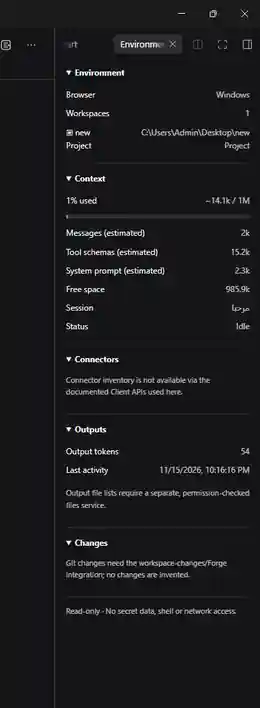

# Environment & Context

**Enabled by default.**

The read-only right-hand sidebar in active Harness conversation sessions displays browser environment, workspace associations, context pressure, estimated token categories, model output-token totals and last recorded activity. Connector and file-change data is unavailable when DSH provides no authorized source. Estimated categories should be treated as approximate accounting.

## Controls

Toggle **Environment & Context** in the suite's Components list. Disabling removes its sidebar registration, conversation-header action, session subscription and pending auto-open timers. Re-enabling restores them. Humanizer has its own independent switch.

The inspector opens once per visible session during each active Component lifetime. Reopen it with the Environment conversation-header button. Suite update controls remain on the suite's Plugins detail page.

## Integration

The Host module is `@abinadwan/dsh-plugins-suite/environment-context`. Its locale and icon resolve through `/environment-context/locale/en.json` and `/environment-context/icon`. The package-root browser carrier mounts the inspector in a scoped Cordis fiber only while the access-checked Host inventory reports the Component enabled and active.

Session state and `contextPressure`, `contextBreakdown` and `tokenUsage` projections supply the inspector. Inventory failure pauses its UI until a successful change-event or reconnect refresh. The suite reads summaries and registers zero filesystem, shell or credential tools for this Component.

## Verification

Tests exercise native sidebar registration, auto-open, projections, independent disable/re-enable, out-of-order inventory responses, access withdrawal and cleanup. Real React rendering is also checked.

[Suite overview](../../README.md)
